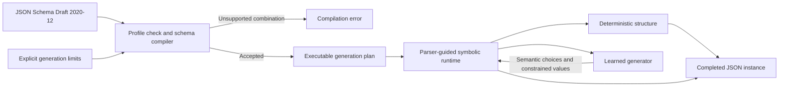

# JSON Schema Conformance Research

A hybrid model–parser architecture for generating structured application data conforming to a precisely defined subset of **JSON Schema Draft 2020-12**.

**Status:** research proposal and baseline coverage audit. The proposed compiler, runtime, formal guarantees, and performance improvements are not yet implemented or established. The system name is undecided (`<NAME>`). Historical cache-management code and experiments have been removed from this revision; earlier revisions remain in Git history.

## Abstract

The following is the proposed abstract. Its guarantee describes the intended design contract, not a completed verification result. Baseline observations concern the audited versions and workloads, not every current decoder or schema.

Agentic AI workloads often require transforming natural-language intent and reasoning into actions and state (e.g., API calls, inter-agent requests, database records) that must conform to a formal schema (generally in JSON format). However, LLM models struggle to conform to JSON schema specifications, creating issues for these workflows. XGrammar and llguidance use token masks to enforce schema compatibility, but these approaches only support restricted subsets of JSON schemas, sometimes produce schema-violating output, and often do not ensure completion in a finite token budget.

We propose &lt;NAME&gt;, a hybrid model-parser architecture for generating output that conforms to a subset of JSON Schema Draft 2020-12, including conditional field rules, field dependencies and exclusions, scoped uniqueness, bounded matching-item requirements, and compatible overlapping key constraints. A schema compiler produces executable generation plans that separate deterministic structure from semantic choices. The parser executes these deterministic plan to create a schema-satisfying outline, and the learned generator resolves semantic choices and fills in the holes left in the schema-satisfying outline. This design guarantees schema conformance by construction, with unsupported combinations rejected during schema compilation. Evaluation will measure coverage, schema conformance, semantic quality, and serving efficiency against constrained decoding.

## Architecture

The plan is the interface between schema semantics, learned generation, and serving. It exposes fixed structure, permitted choices, value holes, and scoped state. The learned component may be an existing autoregressive model or an architecture designed for structured infilling. A partial outline must retain a valid completion; it is not itself necessarily a complete schema-valid JSON value.

## Read the proposal

- [Architecture and proof obligations](docs/architecture.md): compiler, runtime, learned interface, serving, and completion guarantees.
- [Proposed generation profile](docs/generation-profile.md): feature scope and excluded combinations.
- [Baseline coverage](docs/coverage.md): XGrammar, llguidance, and JSONformer with pinned source references.
- [Illustrative schemas and instances](docs/examples.md): 29 numbered examples with valid and invalid instances.
- [Evaluation and evidence](docs/evaluation.md): retained studies, limitations, metrics, and baselines.
- [Original coverage document](docs/JSON_out_of_scope.docx): the earlier five-page report; its website links require the local study viewer. Use the Markdown examples above for GitHub browsing.

## Research contribution

The proposed contribution is a compiler–runtime contract joining richer structural coverage, provable conformance, and efficient execution. Fixed-token insertion, constrained generation, parsing theory, and batching are established techniques; their use alone is not a novelty claim. The design must establish a concrete advantage over [JSONformer](https://github.com/1rgs/jsonformer), [Guidance](https://github.com/guidance-ai/guidance), [SGLang](https://arxiv.org/abs/2312.07104), and [SchemaFill](https://arxiv.org/abs/2610.07086), as well as the audited decoder baselines.

## Repository contents

| Path | Contents |
|---|---|
| `docs/` | Proposal, architecture diagrams, profile, coverage, and examples |
| `experiments/specs/` | Frozen baseline schemas, instances, and suite selection metadata |
| `experiments/results/` | Selected saved compiler/probe records and completion analysis |

The retained directory names are provenance identifiers from the original studies. This publication contains selected evidence, not a complete runnable experiment environment or all raw generation traces.
