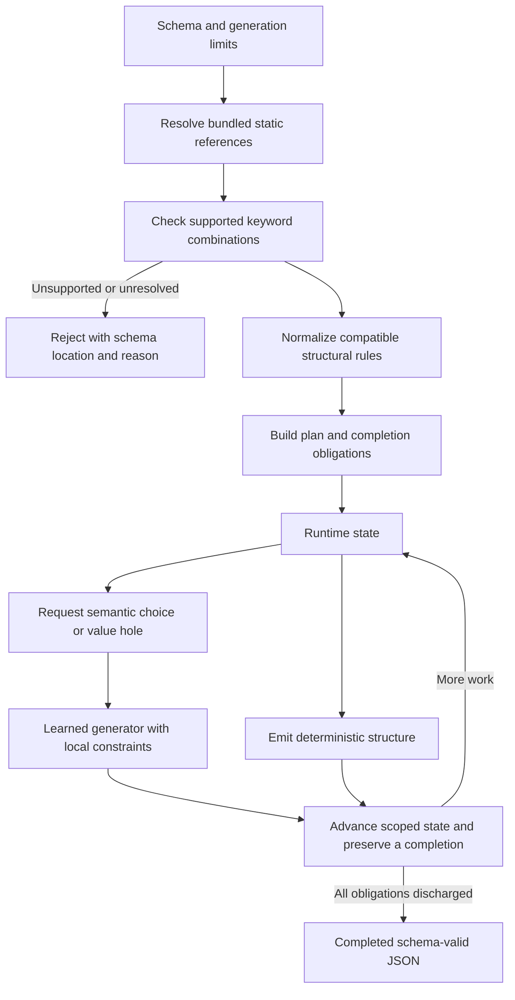
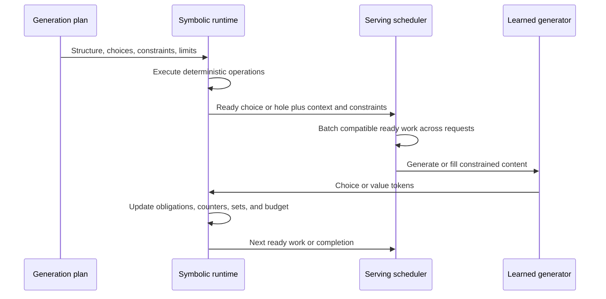

# Proposed model–parser architecture

## Contract

Compile a declared generation profile of JSON Schema Draft 2020-12 into an executable plan. The compiler accepts only supported combinations and rejects unsupported or unresolved constraints. It must not silently discard assertions. A learned generator resolves semantic choices and fills constrained holes; the runtime owns structural obligations.

The model interface is deliberately open: sequential generation, infilling, or an architecture designed for coordinated hole filling may implement it. Parallel filling is permitted only when the plan and conditioning semantics justify it; schema independence does not establish semantic independence.

## Compilation and execution

Illustrative plan operations are `emit`, `choose`, `fill`, bounded `repeat`, and enter/leave scope. These names describe responsibilities, not a finalized instruction set. Runtime state includes the structural stack, chosen layout, required/seen fields, counters, uniqueness sets, and remaining completion budget.

For an active scientific record, choosing `status = active` activates a nonempty publications obligation. The runtime supplies the field and array structure; the generator supplies publication content. Conformance does not establish that those publications are real.

## Serving integration

Potential optimizations include batching ready holes, sharing immutable compiled plans, and processing deterministic spans without sampling each token. For an autoregressive implementation, inserted spans still need correct tokenization and context processing. Removing sampling is not removing all model work. Avoid global synchronization barriers: requests with different layouts or hole lengths should make progress independently.

The scheduler and plan representation remain design work. Evaluate their benefits against existing jump-forward execution, ordinary continuous batching, and slot-oriented speculative approaches; do not assume a benefit merely from integrating with serving.

## Formal obligations

| Property | Intended statement | Necessary qualification |
|---|---|---|
| Compiler soundness | Every completed execution of an accepted plan satisfies the original schema | Prove the schema-to-plan translation and runtime rules, not only JSON parsing |
| Progress | Every permitted choice retains a valid completion | Intersecting individually sound token masks alone does not prove this |
| Bounded termination | Execution finishes under explicit finite limits and adequate reserved budget | Bound strings, arrays, nesting, and control loops; assume generator calls return |
| Serialization correctness | Emitted bytes and token boundaries represent the intended JSON values | Handle escaping, multi-event tokens, canonical serialization, and model context consistently |

These are proof targets, not completed proofs or machine-checked verification. The bounds restrict output coverage relative to the unrestricted schema. Reject a schema/budget combination if a supported completion cannot be established. Successful generation and the ability to emit every valid instance are different properties.

## Efficient state versus general solving

| Earlier examples | Mechanism | Scoped cost or limit |
|---|---|---|
| [Fixed fields and order](examples.md#row-12) | Known-key bitsets and stack transitions | k bits track k known keys; explicit DFA enumeration can require 2^k states |
| [Key patterns](examples.md#row-7) | Regular key predicates plus compatible value-rule intersection | Direct DFA product has at most the product of component state counts |
| [Dependencies](examples.md#row-10) | Precomputed positive dependency graph | O(k+e) closure for k fields and e edges; excludes arbitrary dependentSchemas |
| [Finite conditionals](examples.md#row-14) | Branch dispatch and compiled layouts | Explicit branches use total branch size; enumerating all interacting choices may expand exponentially |
| [Matching items](examples.md#row-26) | Simple classifier and saturated counter | Counter uses O(log(M+1)) bits for bound M; classification has its own cost |
| [Uniqueness](examples.md#row-25) | Scoped sets with exact collision checks | Expected O(B) hashing work for B string bytes; O(B) retained data; prefix exclusion needs additional machinery |
| [String patterns and lengths](examples.md#row-18) | Precompiled DFA and length monitor | Constant transition work per decoded character; determinization may expand exponentially |

These are monitor-level arguments, not vocabulary-wide masking or GPU latency bounds. Counting bytes and hashing completed strings does not prove efficient prefix-safe exclusion. That mechanism must be specified and measured.

General schema reasoning remains a boundary: recursive classical schema-logic satisfiability without uniqueness is EXPTIME-complete; modern validation with dynamic references is PSPACE-complete in combined/schema complexity. These results do not make the small examples above hard. Eliminating annotation-dependent keywords may require exponential schema growth, so native state can be preferable to blanket rewriting. None of these claims establishes undecidability of the proposed profile.

Sources: [Bourhis et al., 2017](https://arxiv.org/abs/1701.02221), [Attouche et al., 2024](https://arxiv.org/abs/2307.10034), [Attouche et al., 2025](https://arxiv.org/abs/2503.11288).
